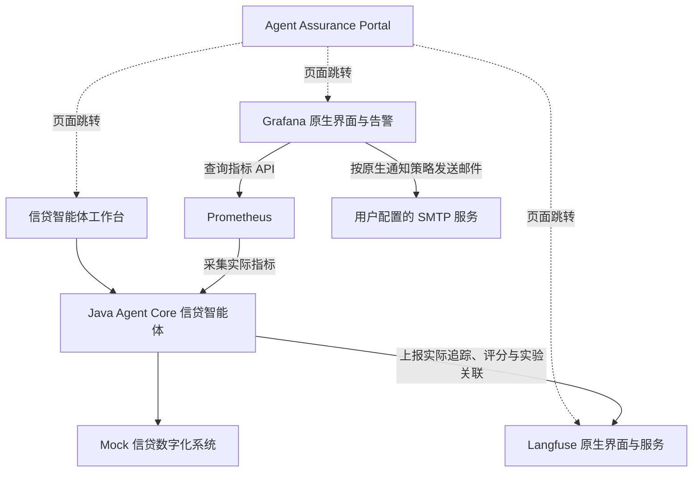

下面这份可以直接交给 Superpowers，按最后确认的范围重新开发，不依赖之前的源码或交接记录。

# 智能体质量保障演示平台——需求说明

## 1. 项目目标

开发一个面向**单个银行信贷智能体**的质量保障演示平台。

平台展示智能体全生命周期的关键保障能力，但**本次迭代只实现可观测、评测及运行告警**，其他能力灰显，后续实现后逐步点亮。

交付物包括：

1. 独立的 Agent Assurance Portal。
2. 独立的信贷智能体前端与 Java 后端。
3. 集成 Langfuse、Prometheus、Grafana。
4. 本地 Docker Compose 一键演示及完整文档。

开发前必须完成实际框架能力调研、系统架构、技术选型和 UCD；随后分阶段开发并验证完整链路。

## 2. 产品边界与系统关系

必须遵守：

- Portal 与信贷工作台是两个独立站点。
- Portal 负责质量保障旅程和能力导航，不承担业务办理。
- 追踪、评测详情、监控和告警配置优先使用开源组件原生界面。
- 不重复实现 Langfuse Trace 页面、评测编辑器、Grafana 仪表盘或通知管理界面。
- 本轮不做部署管理、A/B 部署、版本流量路由、自动回滚或自动风险处置。
- Docker Compose 是演示运行方式；Portal 中的部署与发布能力仍灰显。

## 3. 开发前的必要调研与技术选型

### 3.1 核查 openJiuwen Agent Core

先查看 **Java 与 Python 两个版本的官方源码和文档**，形成能力矩阵，再设计界面和指标。

至少核查：

- Agent、模型、工具、Skill 的执行机制。
- 调用开始、完成、异常等回调或事件。
- Trace、Span、输入输出、耗时、错误信息。
- Token、成本、流式首字延迟等字段是否实际可得。
- 指标导出与 OpenTelemetry 支持情况。
- 内置评测器、评测接口和自定义评测扩展方式。
- Java 与 Python 的能力差异。

矩阵需要注明：**版本/提交、官方来源、原生支持、需要应用适配、当前不支持**。

信贷智能体必须使用 **Java Agent Core**。调研 Python 不意味着再开发一套 Python 信贷智能体。

如果 Core 没有完整 Prometheus 端点，可以在应用层补充实际执行埋点，但必须说明来源，不能宣称 SDK 原生具备。

### 3.2 推荐技术方向

优先考虑：

| 部分 | 推荐方向 |
|---|---|
| 信贷后端 | Java Agent Core，轻量 HTTP 服务；可采用 Spring Boot |
| 指标 | Micrometer/Actuator 或等效实际指标导出 |
| 前端 | React、TypeScript，成熟组件库 |
| 产品设计参考 | AWS 控制台、Cloudscape 的信息层级与交互方式 |
| 追踪与评测 | Langfuse |
| 指标采集与展示 | Prometheus、Grafana |
| 告警 | 优先 Grafana 内置告警与原生通知能力 |
| 运行方式 | Docker Compose |

AWS 用于学习产品设计，本地演示不依赖 AWS 账号或云资源。

具体版本根据当前兼容性验证后锁定，并记录选型依据。避免不必要的 Kubernetes、微服务拆分和额外基础设施。

## 4. Portal 的 UCD 要求

Portal 的独有价值是**完整的智能体质量保障旅程**。

生命周期地图至少包含：

| 阶段 | 本轮状态 |
|---|---|
| 设计与开发 | 灰显、规划中 |
| 测试与评估 | 点亮 |
| 部署与发布 | 灰显、规划中 |
| 运行与观测 | 点亮，包含运行告警 |
| 风险处置与持续改进 | 灰显、规划中 |

当前提供四组保障入口：

- **执行追踪**：跳转 Langfuse 当前项目的 Trace 页面。
- **运行指标**：跳转预置 Grafana 仪表盘。
- **运行告警**：跳转 Grafana 告警规则及 Contact points。
- **数据集与评测**：跳转 Langfuse 数据集、实验和评分详情。

另外提供独立的“打开信贷工作台”入口。

交互要求：

- 中文界面，生命周期地图是主要内容。
- 未来能力灰显，不提供可点击的假功能。
- 原生工具在新标签页打开，保留 Portal。
- 明确跳转目的和用户接下来在哪里操作。
- 支持配置非敏感的服务地址、项目和仪表盘标识。
- 不在 Portal 保存模型密钥、邮箱收件人或 SMTP 凭据。
- “本轮支持该能力”与“服务当前健康”必须区分，不显示虚假绿灯。

## 5. 信贷智能体工作台

采用**左侧菜单、右侧操作区域**，包含四项菜单。

### 5.1 对话

- 用户输入信贷分析任务，Agent 根据实际 Skill 执行。
- 模型调用真实服务，银行接口返回 Mock 数据。
- 展示分析建议、依据、缺失材料和人工处理原因。
- 可查看本轮实际 Skill、工具调用、Mock 来源及错误。
- 每次运行提供对应 Langfuse Trace 入口。
- 展示真实执行状态，正确处理生成失败、断流和终态未知。
- 防止重复点击造成重复执行。

智能体提供辅助分析，不执行真实审批或放款。

### 5.2 Skills 能力库

展示实际加载的 Skill：

- 名称、用途、版本或内容标识。
- 加载状态、绑定工具。
- 实际 Skill 文档及示例。

首轮业务能力建议覆盖：

- 材料核验。
- 征信查询。
- 还款能力测算。
- 信贷政策校验。
- 建议汇总。
- 人工转交。

Skill 必须通过框架真实机制参与执行，不能只在界面显示名称，或由模型文字声称“调用了 Skill”。

### 5.3 模型服务

支持用户配置真正的模型服务：

- 协议或 Provider。
- Base URL、模型 ID、API Key。
- Temperature、最大输出长度、超时等必要参数。
- 保存配置及实际连通性/能力测试。

首轮优先支持 Java Core 已验证可用的 OpenAI-compatible 服务。

要求：

- 测试实际文本生成、工具调用和流式能力，明确可能产生费用。
- 没有配置模型时允许启动平台，但对话应提示配置。
- 生产运行不能自动回退到 Mock 模型或固定答案。
- 密钥不回显、不进入日志、Trace 或浏览器持久存储。
- 配置更新应用于新对话，已有对话保持快照。
- 支持的认证和协议范围以实际 SDK 验证结果为准。

### 5.4 Mock 银行

展示合成案例与接口事实，明确标识为 Mock。

建议至少包含：

1. 材料齐全。
2. 缺少收入证明。
3. 高负债。
4. 征信接口超时。
5. 政策冲突。
6. 客户备注包含提示注入内容。

Mock 位于银行工具适配层，不能用前端固定回复替代 Agent 执行。

## 6. 可观测与 Grafana 仪表盘

必须根据 Core 实际暴露能力及应用真实埋点设计面板。

首轮重点包括：

- 请求量、技术完成量与失败量。
- 端到端耗时及分位数。
- 模型调用次数、耗时和错误。
- 工具调用次数、耗时和错误。
- Skill 加载、激活、使用或错误事件，以实际机制为准。
- Java 进程、JVM、内存、GC、线程等运行资源。

每个面板应能说明：

**指标含义 → 数据来源 → 标签 → 查询 → 覆盖范围和限制。**

约束：

- 不支持的 Token、成本等维度不能伪造为零。
- 技术成功率不能称为业务正确率。
- 完全缺失的数据不能补成健康状态。
- Prometheus 标签保持有界，客户、会话、运行和 Trace ID 不作为普通指标标签。
- 单次问题通过 Langfuse 追踪定位。
- Docker 启动时自动初始化 Grafana 数据源和仪表盘，无需手工导入 JSON。

## 7. 评测与回归比较

评测目标：

- 智能体是否满足信贷业务要求。
- 问题发生在哪个案例、步骤或输出字段。
- 与之前实验相比是否退化。

实现要求：

- 优先使用 Agent Core 实际可用的评测接口或扩展。
- 不足部分用薄适配实现信贷业务规则。
- Java 侧实际运行 Agent，产生预测输出并评分。
- 数据集、实验、逐例结果和分数关联到 Langfuse。
- 评测执行可通过 Runner、命令行或 API 触发，不在 Portal 重建评测平台。

首轮规则建议覆盖：

- 建议类别是否符合预期。
- 关键材料是否遗漏。
- 计算是否正确。
- 政策引用是否正确。
- 征信缺失或超时时是否保守处理。
- 是否保留人工审批边界。

必须明确评分范围：

- 结构化字段检查不能宣称验证了任意自然语言语义安全。
- LLM Judge 只有配置并验证真实裁判模型后才能标记可用。
- 执行失败、评判失败、业务零分、尚未评测应分开表示。
- 不以空数据集或预填分数证明完成评测。

回归比较要求：

- 至少能展示两个实际执行的实验。
- 比较使用一致的数据、规则及可识别的配置版本。
- 一整批评测冻结模型、Skill、数据和规则配置。
- 无需同时部署新旧两个 Agent，也不做 A/B 流量分配。

## 8. 告警演示与邮箱配置

优先复用 Grafana 内置告警能力，完成技术选型和集成设计。

首轮建议覆盖：

- 征信工具持续错误。
- 请求延迟异常。
- 指标采集链路异常。

阈值根据演示流量设置为可解释、可修改的初始值，并处理低流量、NoData 和查询错误。

邮箱配置：

- 用户在 Grafana 原生 Contact points 输入自己的邮箱。
- 使用 Grafana 原生通知策略。
- SMTP 通过服务端环境配置。
- 不需要 Mailpit，不开发 Portal 邮箱或 SMTP 表单。
- 默认演示规则可暂停，避免启动即产生通知。
- 已配置的收件人、规则和暂停状态应在重启后保留。

告警必须由**实际 Agent/Mock 接口故障产生的真实指标**触发，并验证恢复。不能直接写入一个虚假的“告警中”状态。

真实邮件送达需在配置可用 SMTP 后验证；缺少 SMTP 时必须说明未验证。自动化测试默认不发送真实邮件。

## 9. 本地启动与配置持久化

提供一个完整启动命令，可使用 Docker Compose 或一层很薄的启动脚本。

应自动完成：

- 构建并启动两个站点、Agent 和必要开源依赖。
- 创建必要的本地配置。
- 初始化 Grafana 数据源、仪表盘和演示告警。
- 初始化 Langfuse 项目及评测数据集。
- 检查必要服务是否可用。

同时支持 Agent 手工独立启动。

建议默认端口：

| 服务 | 端口 |
|---|---:|
| Portal | 8080 |
| 信贷工作台 | 8081 |
| Agent 后端 | 8082 |
| Langfuse | 3000 |
| Grafana | 3001 |
| Prometheus | 9090 |

这些端口可以统一配置修改，默认链接必须与实际服务一致。

其他要求：

- 两个站点的根路径直接打开正确应用。
- 初始化可重复运行，不覆盖用户的原生配置。
- 模型配置、必要密钥、数据集、实验和通知设置按声明持久化。
- 明确哪些历史仅保存在内存。
- 为代理环境正确配置内部服务的 NO_PROXY。
- 保持 TLS、包校验和认证有效。
- 说明支持的本地系统、资源需求和前置条件。
- 不依赖旧云环境的缓存目录、本地镜像别名或私有代理地址。

## 10. 端到端验收标准

必须提供可复现的完整演示链路：

1. 一条命令启动，两个独立站点可用。
2. 信贷界面保存真实模型配置并进行实际能力测试。
3. 查看真实加载的 Skill。
4. 正常案例完成实际 Skill/工具调用。
5. 征信超时案例展示错误和人工处理建议。
6. 从业务运行或 Portal 打开实际 Langfuse Trace。
7. 运行评测并在 Langfuse 查看实际样本、分数与实验。
8. 比较两个实验，展示可解释的回归变化。
9. Grafana 显示真实运行指标。
10. 实际故障触发告警，恢复后告警解除。
11. 重启后确认约定的配置和数据保留。

自动化可使用**显式的测试专用模型接口**验证协议和集成，但必须：

- 与生产默认运行分离。
- 不作为生产兜底。
- 清楚区分“测试接口通过”和“真实模型质量验证”。
- 不把 HTTP200、健康检查或页面截图单独当作完整验收。

## 11. 开发与交付要求

- 先调研、架构和 UCD，再分阶段实现。
- 每阶段形成可运行、可测试的交付，及时提交并推送工作分支。
- 保留真实远端分支和提交号，避免代码长期仅存云工作区。
- 不覆盖既有代码，不强推主分支。
- 完整交付 README、架构与选型说明、启动步骤、演示步骤、测试结果及已知限制。
- 交接文档必须随代码入库，不依赖被 Git 忽略的临时报告。
- 密钥、私密环境文件、运行数据和认证会话不能入库。
- 重要问题修正后进行独立审查，完成最终端到端验证。
- 清楚标记已完成、未完成、未验证，不能用假数据或通过截图掩盖集成失败。

本轮不扩展需求：不做部署管理、A/B、真实银行系统接入、自动审批放款，也不另建一套开源组件已经提供的专业界面。